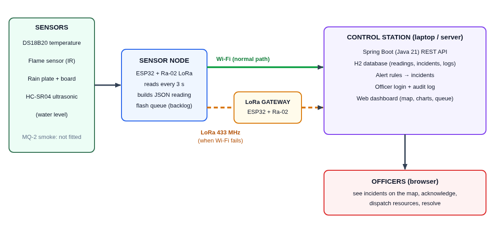
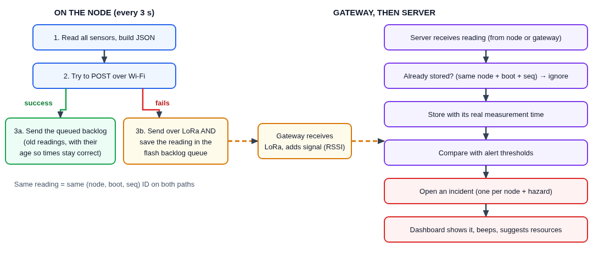

# Disaster Communication & Resource Management

A working IoT system that watches for floods, fire and heat, keeps reporting when Wi-Fi or the Internet fails,
and gives control-room officers a live dashboard to acknowledge, allocate resources and resolve incidents.



**How it works.** An ESP32 sensor node reads water level, rain, flame and temperature every 3 seconds and posts to the
control station over Wi-Fi. If Wi-Fi or the server is unreachable it falls back to **LoRa** (433 MHz Ra-02) to a gateway ESP32,
and keeps every unsent reading in flash to replay later with its true measurement time. The control station (Spring Boot)
applies alert rules, opens incidents, notifies officers on Telegram, and syncs to a hosted cloud (Render + Neon Postgres).



## What is built

| Area | What it does |
|---|---|
| Sensors | HC-SR04 water level, rain plate, HW-072 flame, DS18B20 temperature (MQ-2 smoke supported in code, not fitted) |
| Link fallback | Wi-Fi first; on failure LoRa **and** a flash backlog (200 readings). On recovery the backlog is replayed with `age_ms` |
| No duplicates | Readings carry (node, boot, seq); server and cloud drop repeats |
| Gateway | Receives LoRa, forwards over Wi-Fi, or over USB to the PC (`scripts/gateway-bridge.py`) when there is no Wi-Fi at all |
| Alert rules | Flood, fire, heat, heavy rain, smoke; thresholds editable from the dashboard |
| Incidents | One per node and hazard until resolved; suggested resources; acknowledge, allocate, assign, resolve |
| Officers | Login (PBKDF2 hashed), audit log of every action, per-node responsible officer |
| Telegram | Instant alert to the responsible officer or all on-duty officers, with retry while offline |
| Dashboard | Map-first ops view, node table, live instrument tiles and charts, incident queue, resources, activity |
| Cloud | Store-and-forward upload to a hosted copy (Render + Neon Postgres), catches up after outages |

## Repository layout
```
server/     Spring Boot 4 / Java 21 backend + dashboard (index.html) + cloud page (cloud.html)
firmware/   PlatformIO: env `node` (sensors) and env `gateway` (LoRa receiver)
scripts/    gateway-bridge.py (USB fallback), node-wifi-outage.sh / .ps1 (demo: cut Wi-Fi)
backend/    original Python prototype with the same API; sim.py is a fake node
docs/       wiring diagrams, hardware list, project-explained.pdf
```

## Quick start (no hardware)
```
cd server
# JDK 21 required (Linux fish: set -x JAVA_HOME /usr/lib/jvm/java-21-openjdk)
./mvnw spring-boot:run          # Windows: mvnw.cmd spring-boot:run   -> http://localhost:8000
cd ../backend && python sim.py flood     # fake node that triggers a flood alert
cd ../server && ./mvnw verify            # 9 tests
```
Data lives in `server/data/` (H2 file database). First start creates the officer `admin` / `admin123`; a warning is printed.
**Change it** with `DISASTER_ADMIN_PASSWORD` (or `disaster.admin.password`) before any real use.

## Hardware
Two ESP32 DevKit boards (node, gateway) and two Ra-02 SX1278 LoRa modules. Full list in [docs/hardware-list.md](docs/hardware-list.md).

| Part | Pin |
|---|---|
| Ra-02 radio | SCK 18, MISO 19, MOSI 23, NSS 5 (3.3 V only) |
| DS18B20 | data D4 (4.7 k pull-up), power from D15 |
| Flame HW-072 | DO to D27 (LOW = flame), power D15 |
| Rain board | AO to D32, power from D13 |
| HC-SR04 | Trig D25, Echo D33 through a 2.2 k / 4.7 k divider (echo is 5 V), VCC 5 V |

Wiring diagrams: [gateway](docs/gateway-wiring-image.png), [DS18B20](docs/ds18b20-gpio-wiring.png),
[flame](docs/flame-wiring.png), [sonar divider](docs/sonar-divider.png). Mount height, thresholds and intervals are in
`firmware/include/config.h` (`MOUNT_CM`, `INTERVAL_MS`, `RAIN_WET_RAW`, `HAVE_SMOKE`).

**Radio frequency:** the demo uses 433 MHz because that is what the Ra-02 modules are. The licence-free band in India is
865-867 MHz, so use an 865 MHz module for any real deployment.

## Firmware
```
pip install platformio
cd firmware
cp include/secrets.example.h include/secrets.h     # Windows: copy
# edit secrets.h: Wi-Fi name/password and SERVER_URL = the PC's LAN IP, port 8000
pio run -e node -t upload
pio run -e gateway -t upload
```
`secrets.h` is git-ignored. Linux serial access: add your user to `uucp` (Arch/CachyOS). Windows: install the CP210x driver and
allow TCP 8000 in the firewall. Boards can swap between `/dev/ttyUSB0` and `1`; identify them by MAC (`esptool chip_id`).

## Dashboard
- **Login:** viewing is open; acknowledging, allocating, assigning, resolving, thresholds and placing nodes need an officer login.
- **Map and nodes:** online/offline (no data for 60 s), Wi-Fi vs LoRa link, signal strength. Place a node by clicking the map.
- **Instruments:** live tiles for water level, rain, temperature, flame (with a 30-minute timeline) and charts.
- **Alerts:** sound, banner and browser notification for new incidents or a node going offline.
- **Thresholds:** Flood level >= 50 cm, fire = flame, smoke >= 2000, heat >= 50 C, heavy rain >= 80. Editable in the dashboard.

## Wi-Fi outage and recovery
`scripts/node-wifi-outage.sh on|off|all-on|all-off|ip` blocks the node's (and optionally the gateway's) Wi-Fi with firewall rules
so you can show the fallback live (run with sudo in a separate terminal; PowerShell version: `node-wifi-outage.ps1`).
- **Only the node blocked:** the node switches to LoRa, gateway forwards, no readings lost.
- **Whole Wi-Fi down:** run `scripts/gateway-bridge.py`; it reads the gateway's USB serial and posts to the server, so LoRa
  readings still arrive with no Wi-Fi anywhere.
- **Server down:** the node queues in flash and replays on recovery; verified 31 of 31 readings with true timestamps.

## Officer notification (Telegram)
When an incident opens, the responsible officer gets: severity, hazard, node, reading against threshold, observed time, incident ID
and a dashboard link. Recipients are the node's **responsible officer** if set, otherwise every linked officer who is **on duty**.
Acknowledging claims the incident; an officer can also **assign** it to someone else, who is messaged too. Messages queue and retry
while Telegram is unreachable (up to 24 h). Off unless a bot token is set.

1. In Telegram message **@BotFather**, send `/newbot`, copy the token.
2. Put it in `server/config/application.properties` (git-ignored), never in git or chat:
   ```
   disaster.telegram.token=<token>
   disaster.public-url=http://<PC LAN IP>:8000
   ```
3. Each officer: sign in, **Notifications**, **Link Telegram**, send the bot `/link CODE` (single-use, 10 minutes).

Telegram needs Internet. In a total outage the dashboard sound and banner are the channel; queued messages go out on return.

## Cloud storage (store-and-forward)
Every reading is stored on the control station first. When a cloud is configured, the station uploads what the cloud has not
confirmed (every 10 s, up to 500 readings per batch, plus a snapshot of nodes, incidents, resources and activity), advances its
marker only on HTTP 200, and keeps data queued while the Internet is down. The cloud ignores repeats, so retries are safe.
Accounts and password hashes are never uploaded. The dashboard shows "Cloud sync: Synced / N queued, offline / Off".

The cloud is the same app with a receiver key; its read-only page is `/cloud.html`. Live demo: https://disaster-comm.onrender.com/cloud.html

### Deploy your own: Render + Neon Postgres (free)
1. **Neon** (neon.tech): create a project; note host, database, user, password.
2. **Render** (render.com): New > Web Service > this repo, Root Directory `server`, Runtime Docker, free plan. Environment variables:
   - `SPRING_DATASOURCE_URL` = `jdbc:postgresql://<neon-host>/<db>?sslmode=require`
   - `SPRING_DATASOURCE_USERNAME`, `SPRING_DATASOURCE_PASSWORD` from Neon
   - `DISASTER_CLOUD_RECEIVER_KEY` = a long random string (`openssl rand -hex 24`)
   - `DISASTER_ADMIN_PASSWORD` = something strong
3. Point the control station at it:
   ```
   DISASTER_CLOUD_URL=https://<your-app>.onrender.com DISASTER_CLOUD_KEY=<same key> DISASTER_STATION=chennai-control java -jar target/server-0.0.1-SNAPSHOT.jar
   ```
   PowerShell: `$env:DISASTER_CLOUD_URL="..."` first. With no `DISASTER_CLOUD_URL` the feature is off.
4. Free Render sleeps when idle (first request takes about a minute); the station just retries.

Local stand-in without an account: run a second copy with `SERVER_PORT=8100 DISASTER_CLOUD_RECEIVER_KEY=demo-key SPRING_DATASOURCE_URL=jdbc:h2:file:./data/cloud`.

## Windows
Needs JDK 21 (Temurin), Git and, for the simulator, Python 3. In PowerShell:
```
git clone https://github.com/vanshdev0101/disaster-comm.git
cd disaster-comm\server
.\mvnw.cmd spring-boot:run          # then open http://localhost:8000
cd ..\backend; py sim.py flood      # second window: fake node
```
Not yet run on Windows by the author.

## Tech stack
ESP32 (Arduino / PlatformIO), LoRa SX1278, LittleFS, Spring Boot 4, Java 21, Spring Data JPA, H2 (station) and Postgres (cloud),
vanilla JS dashboard with Leaflet, Docker, Render, Neon, Telegram Bot API.

## Known limits
- Smoke (MQ-2) and humidity / flow-rate sensors are not fitted. Alert rules run on the server, not on the node.
- One station per cloud instance; the cloud page has no login. The Telegram outbox is in memory (lost on restart).
- 433 MHz is for the demo only (see above). Not yet run on Windows. Node placement and thresholds need calibration on site.

More detail: [docs/project-explained.pdf](docs/project-explained.pdf) (every component, why it is used, how the whole works).
